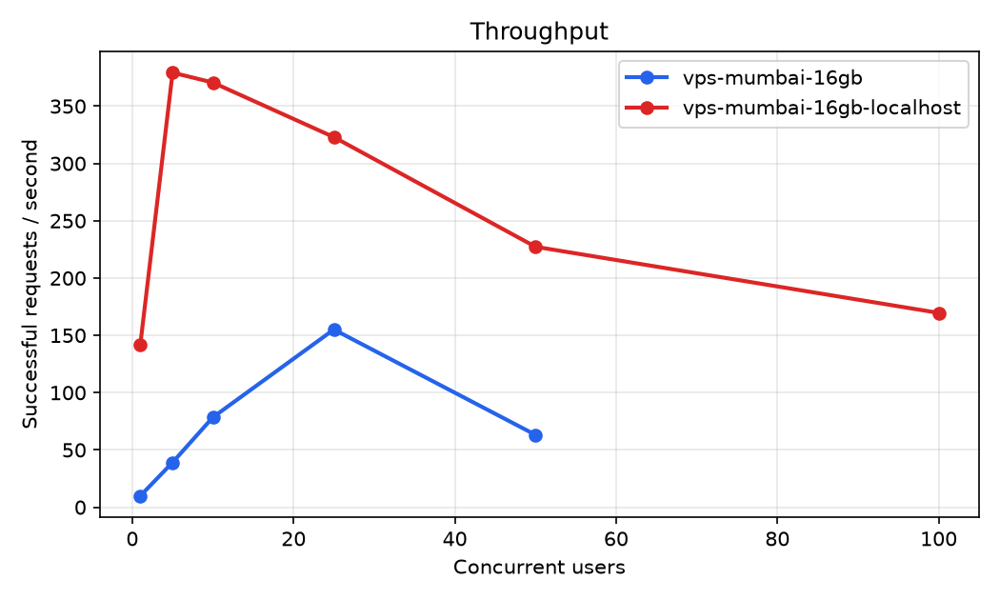
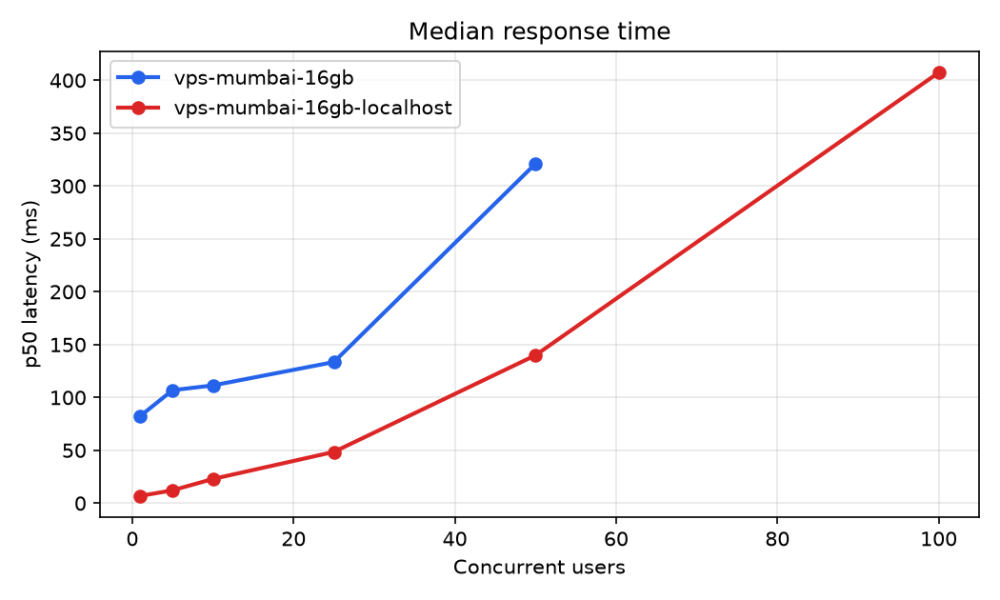

# Mini-Predix: GE Predix Case Study (IT457 Cloud Computing)

Group 27 project for IT457. We study **GE Predix**, GE's industrial IoT cloud platform, and GE's migration
of its IT to AWS. We then rebuild the core idea on a small scale: a sensor-monitoring app that we migrate
from a local setup to cloud servers, measuring the effect at each step.

**Live demo (Mumbai VPS):** http://200.234.36.181:8090

| Student ID | Name |
|---|---|
| 202303009 | |
| 202303046 | Param |
| 202301436 | |

## What the app does

| GE Predix component | Mini-Predix equivalent |
|---|---|
| Industrial machines + Predix Machine (edge) | `simulator/`: 8 virtual turbines, engines and a locomotive send readings every 2 s, with random faults and a store-and-forward buffer |
| Predix Cloud ingestion | `POST /api/readings` (FastAPI) |
| Time-Series service | `readings` table in PostgreSQL |
| Asset service | `assets` table, `GET /api/assets` |
| Analytics | threshold alert rules (`api/app/rules.py`) |
| Digital twin | health score, temperature trend and "time to critical" prediction (`api/app/twin.py`) |
| Industrial apps | live dashboard at `/` |

```
simulator ──HTTP──> FastAPI API ──> PostgreSQL
                        │
                        └──> dashboard (browser)
```

## Repository layout

| Folder | Contents |
|---|---|
| `week1/` | Week 1 one-page research summary (LaTeX + PDF) |
| `week2/` | Week 2 detailed case study report (LaTeX + PDF) |
| `api/` | FastAPI service, alert rules, digital twin, dashboard, unit tests |
| `simulator/` | Sensor simulator (standard library only) |
| `benchmark/` | Load-testing script, plotting script and saved results |
| `deploy/` | Script that deploys the stack to a VM over SSH |

## Run it

**Phase 1: local (Docker Compose)**
```bash
cp .env.example .env        # set POSTGRES_PASSWORD
docker compose up -d --build
# open http://localhost:8090
```

**Phase 2: lift-and-shift to a VM** (same containers, no code changes)
```bash
deploy/deploy_vps.sh <ssh-host> <deployment-name> 8090
```

**Phase 3: managed database** (planned for AWS): set `DATABASE_URL` in `.env` to an AWS RDS PostgreSQL
endpoint. The API creates its tables on start-up, so nothing else changes.

**Tests**
```bash
cd api && pip install -r requirements.txt pytest && pytest
```

## Benchmark method

`benchmark/benchmark.py` runs 1 to 100 concurrent virtual users for 20 s per level. The traffic is
30% writes (a batch of 6 readings) and 70% dashboard reads. It records response time percentiles,
throughput and errors, and samples the server's CPU, load average and memory every 2 s through
`/api/system`. The API also reports its own processing time in an `X-Process-Time-Ms` header, so we
can separate **server time** from **network time**.

```bash
pip install -r benchmark/requirements.txt
python benchmark/benchmark.py --url http://<host>:8090 --label <name>
python benchmark/plot_results.py      # graphs in benchmark/results/graphs/
```

## Results: Mumbai VPS (16 GB RAM, 4 vCPU)

We ran the test twice: from a laptop in Gujarat over the internet, and from inside the server itself
(no network), to separate network effects from server capacity.

| Test | Peak throughput | p50 at 1 user | p50 at 25 users | Errors |
|---|---|---|---|---|
| From laptop (internet, ~78 ms RTT) | 155 req/s at 25 users | 82.5 ms | 133.5 ms | 0% |
| On the server (localhost) | 379 req/s at 5 users | 6.9 ms | 48.5 ms | 0% |




**Observations**
- Over the internet, **network round-trip time dominates**: the server needs only ~18-25 ms per request,
  but users see 80-130 ms.
- At 50 users from the laptop, latency rose sharply while server time and CPU stayed flat, so the
  limit there was the network path and client, not the server.
- On the server itself, throughput peaks around **380 req/s** and CPU reaches ~84%. Beyond 10 users
  requests queue up and p95 latency grows, which is where horizontal scaling or a bigger instance
  would be needed.
- There were **no failed requests** at any level.

Full numbers: [`benchmark/results/summary.md`](benchmark/results/summary.md).
