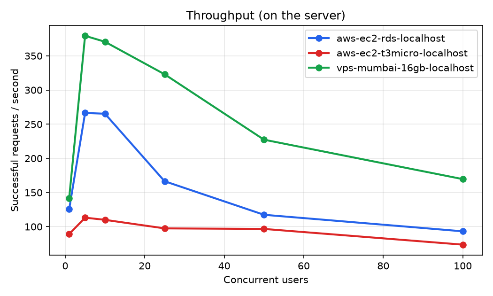
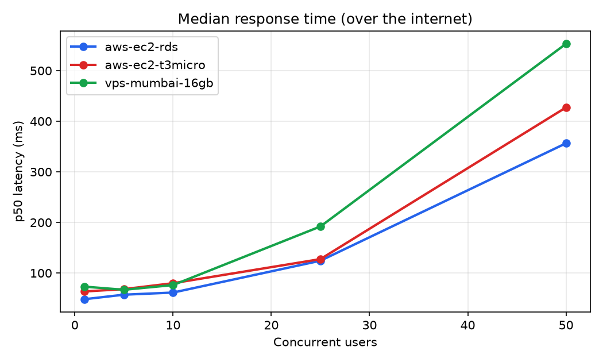
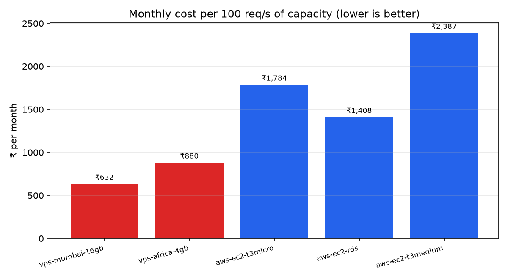
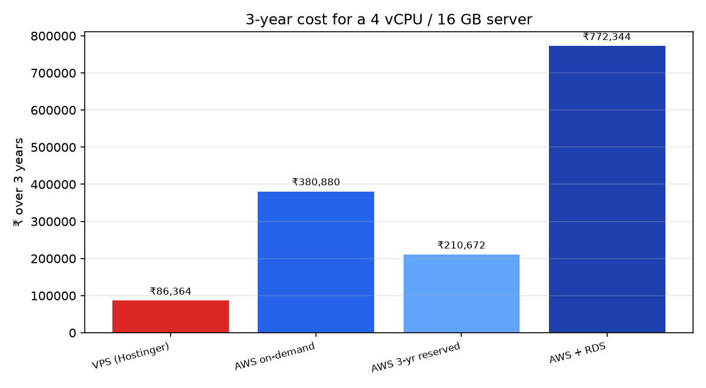
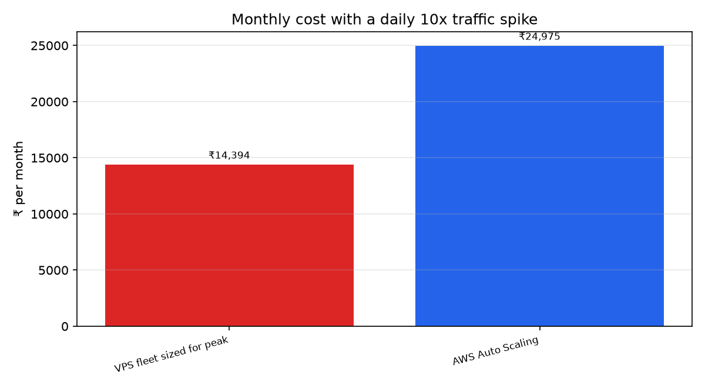

# Mini-Predix: performance, cost and scaling analysis

This document compares where to run Mini-Predix: our own VPS servers or AWS. It mirrors the question
GE faced: run your own infrastructure, or move to a public cloud?

All numbers come from our own load tests (`benchmark/results/`) and the AWS public price list for
Mumbai (`benchmark/costs.json`). 1 USD = ₹96.5.

## 1. What we tested

| Deployment | Where | Machine | Database | Migration phase |
|---|---|---|---|---|
| vps-mumbai-16gb | Hostinger, Mumbai | 4 vCPU, 16 GB | PostgreSQL container | Phase 2 (lift-and-shift) |
| vps-africa-4gb | Africa | 3 vCPU, 4 GB | PostgreSQL container | Phase 2 |
| aws-ec2-t3micro | AWS Mumbai | t3.micro, 2 vCPU, 1 GB | PostgreSQL container | Phase 2 |
| aws-ec2-rds | AWS Mumbai | t3.micro | **RDS db.t4g.micro (managed)** | Phase 3 (refactor) |
| aws-ec2-t3medium | AWS Mumbai | t3.medium, 2 vCPU, 4 GB | PostgreSQL container | Same size as the 4 GB VPS |

Every deployment ran the same code. Moving between them needed **no code changes**: only the deploy
target (Phase 2) or one `DATABASE_URL` setting (Phase 3).

| Step | Time taken |
|---|---|
| Deploy to a new VPS / EC2 VM | 37 to 89 s (one script) |
| Switch from local PostgreSQL to RDS | 40 s (one script) |
| Create an RDS database | ~10 min (AWS provisioning) |

## 2. Performance

Measured on each server itself (no network), 70% reads / 30% writes:

| Deployment | Peak throughput | p50 at 5 users | p95 at 5 users | Errors |
|---|---|---|---|---|
| Mumbai VPS 16 GB | **379 req/s** | 12 ms | 25 ms | 0% |
| AWS t3.micro + RDS | 266 req/s | 18 ms | 34 ms | 0% |
| Africa VPS 4 GB | 193 req/s | 24 ms | 45 ms | 0% |
| AWS t3.medium (4 GB) | 184 req/s | 23 ms | 60 ms | 0% |
| AWS t3.micro (1 GB) | 113 req/s | 19 ms | 159 ms | 0% |

Measured from a laptop in Gujarat over the internet:

| Deployment | Network round trip | p50 at 1 user |
|---|---|---|
| AWS Mumbai | ~40 to 60 ms | 60 to 85 ms |
| Mumbai VPS | ~45 ms | 73 ms |
| Africa VPS | **~347 ms** | 370 ms |

**Findings**
1. **Same size means about the same speed.** The 4 GB Africa VPS (193 req/s) and the 4 GB AWS t3.medium
   (184 req/s) perform almost the same. AWS is not "faster" by itself.
2. **A managed database is the biggest win for a small server.** Moving PostgreSQL off the 1 GB
   t3.micro and onto RDS raised throughput from 113 to 266 req/s (2.4x) and cut p95 latency from
   159 ms to 34 ms, because the database no longer competes for the VM's CPU and memory.
3. **Location matters more than hardware for users.** The Africa server is 7x further away in network
   time than Mumbai. For Indian users, a server in India wins no matter how powerful it is.

## 3. Cost

### Monthly cost of each tested deployment

| Deployment | Monthly cost | Cost per 100 req/s of capacity |
|---|---|---|
| Mumbai VPS 16 GB | ₹2,399 | **₹632** |
| Africa VPS 4 GB | ₹1,700 | ₹880 |
| AWS t3.micro + RDS | ₹3,752 | ₹1,408 |
| AWS t3.micro | ₹2,020 | ₹1,784 |
| AWS t3.medium | ₹4,387 | ₹2,387 |

AWS prices include 200 GB/month of internet traffic (₹1,055), which AWS charges for and our VPS
plans include.

### Same-size machine on AWS

| Our VPS | VPS price | AWS same size (on-demand) | AWS with 3-year commitment | AWS + managed DB |
|---|---|---|---|---|
| Africa 4 GB | ₹1,700 | ₹4,844 (t3.medium) | ₹2,849 | ₹10,936 |
| Africa 8 GB | ₹4,667 | ₹9,496 (t3.large) | ₹5,503 | ₹19,939 |
| Mumbai 16 GB | ₹2,399 | ₹10,580 (m6a.xlarge) | ₹5,852 | ₹21,454 |

Over 3 years, the 16 GB server costs **₹86,364 on the VPS** against ₹2.1 to 3.8 lakh on AWS
(reserved or on-demand), or ₹7.7 lakh with a managed database.

### Scaling scenario: 10x traffic for 4 hours a day

Normal load of 200 req/s, rising to 2,000 req/s for 4 hours every day (like a cricket match or a
Tatkal booking window):

| Option | Setup | Monthly cost |
|---|---|---|
| VPS fleet | 6 Mumbai VPS sized for the peak, running all month | ₹14,394 |
| AWS Auto Scaling | 2 t3.medium always on, up to 11 during the spike, + load balancer | ₹24,975 |

Even with spiky traffic the VPS fleet is cheaper, mainly because AWS charges for internet traffic
(about 40% of the AWS bill here) and our VPS is unusually cheap for its size.

## 4. What the price difference buys

Raw cost favours the VPS. AWS charges more for things a VPS does not include:

| Need | VPS | AWS |
|---|---|---|
| Add capacity | Buy a new server, set it up by hand (hours to days) | Change instance type or Auto Scaling adds servers (minutes, automatic) |
| Database backups | We must script and test them ourselves | RDS: automatic daily backups and point-in-time restore |
| Database failover | Not available; a crash means downtime | Multi-AZ RDS: automatic failover to a standby |
| Server failure | Manual recovery | Replace the instance or let Auto Scaling do it |
| Regions | Only where our provider has servers | 30+ regions worldwide |
| Pay for short use | Monthly or quarterly plans | Per second; our t3.medium test cost about ₹5 |
| Operations work | Patching, monitoring and security are on us | Much is handled by AWS |

At an assumed 4 hours a month of admin work (backups, updates, monitoring) at ₹500/hour, a
self-managed server carries about ₹2,000/month of hidden cost. That is close to the price of a small
RDS database.

## 5. Operations and scaling effort

The VPS wins on price because it is a **bare machine**: we get CPU, RAM and a disk, and everything
else is our job. This section lists what that meant in practice during this project.

### What we had to do ourselves

| Task | VPS (what we did) | AWS (what we did) |
|---|---|---|
| Get a server | Already rented; a new one means ordering a plan from the provider | Launched from the console in about 1 minute |
| Install Docker, add swap, open ports | By hand over SSH | Same by hand on EC2 (still IaaS) |
| Firewall | The Mumbai VPS had no firewall rules (INPUT policy ACCEPT); we would have to set this up | Security group created in the launch wizard; RDS reachable only from EC2 |
| Database setup | PostgreSQL container, password generated by our script | RDS created in ~10 min, password generated by AWS |
| Backups | **None.** We would have to write, schedule and test them | RDS automatic daily backups, turned on by default |
| Database failover | Not possible on one VPS | One option (Multi-AZ) in RDS |
| Monitoring | Only our own `/api/system` endpoint | RDS Database Insights (7 days free) plus our endpoint |
| Moving the DB off the app server | Would need a second server, network setup and data copy | 40-second switch with `deploy/use_rds.sh` |

### A problem we actually hit: noisy neighbours

The Mumbai VPS also runs Grafana, Prometheus, Langfuse and test clients. During our on-server load
test its load average rose from about 0.9 to **7.65 on 4 CPUs**, slowing every other service on the
machine. On a shared, self-managed server one application can starve the others. On AWS, the
database on RDS and each EC2 instance have their own resources, and limits can be set per service.

### How each option scales

| Step to handle more traffic | VPS | AWS |
|---|---|---|
| Bigger machine (vertical) | Upgrade the plan in the provider panel, or rent a new one and migrate data by hand | Stop the instance, change the type, start it (a few minutes) |
| More machines (horizontal) | Rent N servers, install Docker on each, set up and maintain a load balancer (e.g. nginx), point all of them at a shared database | Auto Scaling group behind a load balancer adds and removes servers automatically |
| Shared database for many app servers | Run and secure a separate database server ourselves | RDS endpoint reachable by all instances; scale it with one setting or add read replicas |
| Scale back down after a spike | Plans are monthly or quarterly, so we keep paying for peak capacity | Instances terminate and billing stops per second |
| A server dies | Restore by hand; nothing restarts it | Auto Scaling replaces it; RDS fails over (Multi-AZ) |

In the spike scenario in section 3, the VPS fleet is cheaper on paper (₹14,394 vs ₹24,975), but it
needs **6 servers set up, patched and monitored by hand**, a load balancer we run ourselves, and a
shared database, and it stays sized for the peak all month. AWS does the same job with no manual
steps once it is configured.

### Where the hidden VPS cost comes from

| Hidden cost | VPS | AWS |
|---|---|---|
| Admin time (backups, updates, monitoring) | ~4 h/month assumed, ~₹2,000 at ₹500/h | Much lower for managed services |
| Risk of data loss | High until backups are built and tested | Low (automatic backups) |
| Downtime when hardware fails | Hours, until someone fixes it | Minutes (auto replacement / failover) |
| Time to add capacity for an event | Days (order, set up, test) | Minutes |

**Summary.** The VPS is the cheapest way to *run* Mini-Predix, but the hardest to *operate and
grow*. AWS costs more per unit of capacity, and the difference pays for managed backups, failover,
isolation and automatic scaling. This is the same trade-off GE made when it moved its IT to AWS.

## 6. Recommendation

| Situation | Best choice | Why |
|---|---|---|
| Student project, demo, steady small load | **Mumbai VPS** | Cheapest by far, fast in India, enough capacity (379 req/s) |
| Users mainly in India | Mumbai (VPS or AWS) | ~45 ms vs ~347 ms from Africa |
| Data must never be lost, or downtime is costly | **AWS with RDS (Multi-AZ)** | Managed backups and failover |
| Traffic is unpredictable or grows fast | **AWS** | Scale in minutes without buying servers in advance |
| Long-term steady production load | VPS, or AWS with a 3-year commitment | Commitments cut AWS cost by ~45% |
| Best of both | **Hybrid**: steady base on VPS, managed DB or bursts on AWS | Similar to Flipkart's own-infra-plus-cloud approach |

**Link to the GE case.** GE moved to AWS less for raw price than for speed and less operational
work: its plan to shrink from 34 data centers to 4 meant far less hardware and staff to manage. Our results show
the same trade-off at small scale. Rented servers are cheaper per unit of capacity, which is why
companies like Basecamp and Dropbox moved steady workloads back out of the cloud. Managed services
and elasticity are what the cloud is really selling. GE's Predix also struggled partly because GE
built and ran its own cloud infrastructure instead of using a provider's; the lesson is to use
managed services where they remove real work, and to compare the bill honestly.

## 7. Notes on method

- Each test ran 20 s per concurrency level, 1 to 100 virtual users. Tests on the same server were
  never run at the same time.
- The laptop's internet connection was unstable during one session; those runs were discarded and
  repeated.
- "On-server" tests run the load generator on the same machine, so it shares the CPU with the app.
  This affects every server the same way.
- The RDS database started empty, while the other databases had a few hours of readings. All queries
  use indexes, so this has little effect.
- RDS ran PostgreSQL 18; the containers ran PostgreSQL 16.
